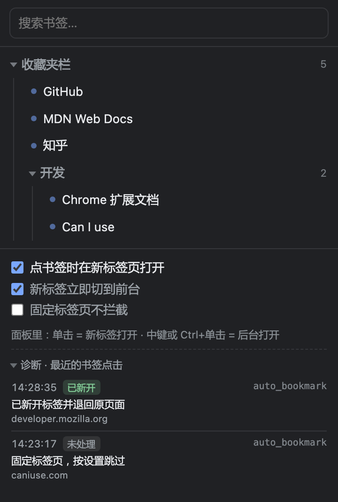

# 书签新标签打开（Bookmark New Tab）

[English](README.md) | **简体中文**

[](LICENSE)
[](manifest.json)

在 Edge / Chrome 里点书签时，**自动在新标签页打开**，不再覆盖当前正在读的网页。

覆盖这两个入口，都是直接点原生书签，不需要改用插件的面板：
- 地址栏下方的**收藏夹栏**
- 顶部菜单栏的**「收藏夹」菜单**（含里面的子文件夹）



---

## 一、安装（30 秒）

1. 打开 `edge://extensions/` （Chrome 用 `chrome://extensions/`）
2. 打开左下角 / 右上角的 **开发人员模式**
3. 点 **加载解压缩的扩展**，选择本目录 `bookmark-newtab`
4. 建议把图标固定到工具栏（点拼图图标 → 图钉）

安装时浏览器会提示「读取和更改您在所有网站上的数据」和「读取和更改您的书签」。
原因：前者是 `webNavigation` 拿完整 URL 的必要条件（没有它事件里的 URL 会被打码），
后者用于工具栏面板列出你的书签。**代码不联网、不上传任何数据**，可自行核对 `src/` 全部源码。

> 已经装过旧版、改了代码？到 `edge://extensions` 点本扩展卡片上的**「重新加载」**，
> 改动才生效（改了 `manifest.json` 也要这样做）。

---

## 二、它是怎么做到的（以及代价）

浏览器不允许扩展监听书签栏的点击 —— 那是 `chrome://` 的浏览器 UI，内容脚本注入不进去。
但 Chromium 内核有个可用的信号：**从书签发起的导航，`transitionType` 是 `auto_bookmark`**。
不管你是点收藏夹栏、点顶部「收藏夹」菜单，还是点书签管理器里的条目，都会带这个标记。

于是流程是：

1. `onBeforeNavigate` 只记录「这次要跳到哪」（此刻标签页还停在原页面）；
2. `onCommitted` 里拿到 `transitionType`，如果是 `auto_bookmark`：
   - 把书签目标新开到相邻标签，默认切到前台（视线先跟过去）；
   - 原标签 `goBack()` 退回上一页 —— 走 bfcache，**滚动位置和页面改动都还在**，不是重新加载。
3. 非 `auto_bookmark` 的导航完全不插手。

**一个实测踩出来的坑（v1.1 就是栽在这里，值得记一笔）**：
`webNavigation.onBeforeNavigate` 的事件对象里**根本没有 `transitionType` 字段**，
实测 keys 只有 `documentLifecycle / frameId / frameType / parentFrameId / processId /
tabId / timeStamp / url`。类型字段只在 `onCommitted` 才有。
把判断写在 `onBeforeNavigate` 里，条件永远不成立，插件会一声不响地什么都不做
（面板诊断也是空的，因为压根没走到记录那一步）。

实测结果（Edge 156，用调试协议构造 `auto_bookmark` 导航复现）：
原页面的 `scrollY`、JS 改过的 DOM 在回来后全部保留。

**唯一的代价**：如果关掉「新标签切到前台」，你会看到原标签闪一下目标页再退回来 ——
因为 committed 事件发生时，目标页已经开始加载，这是我们能拿到类型信息的最早时刻。

---

## 三、零成本替代（不装插件也能用，推荐先试试）

**鼠标中键（滚轮按下去）点书签 = 后台新标签打开**，浏览器原生支持，无需任何插件。
`Ctrl + 单击` 同理，只是要按键盘。如果你能接受中键，其实可以不用这个插件。

---

## 四、工具栏面板（可靠入口）

点扩展图标会打开书签面板，这里的每次点击**一定**按你的意思开：

| 操作 | 效果 |
| --- | --- |
| 单击 | 前台新标签打开 |
| 中键 / Ctrl+单击 | 后台新标签打开 |
| 顶部搜索框 | 按标题或网址实时过滤 |

面板不依赖 `auto_bookmark` 这个内核信号，所以即使某天 Edge 改了导航标记、拦截模式失效，
这条路径依然可用。

---

## 五、设置项

设置存在 `chrome.storage.sync`，跟随 Edge 账号跨设备同步。

| 开关 | 默认 | 说明 |
| --- | --- | --- |
| 点书签时在新标签页打开 | 开 | 总开关，关掉后完全恢复浏览器原生行为 |
| 新标签立即切到前台 | 开 | 关掉则后台打开，不打断当前阅读 |
| 固定标签页不拦截 | 关 | 打开后，被固定的标签页仍按原生行为覆盖 |

当前标签页是**空白新标签页**时不做拦截（直接在里面打开更符合直觉）；
原页面是 `edge://settings` 这类浏览器内部页时也不碰。

---

## 六、验收清单

| 检查项 | 期望结果 |
| --- | --- |
| 加载扩展 | `edge://extensions` 中出现卡片，无红色报错 |
| 打开网页 A（先滚到中间），点书签栏的 B | 新标签打开 B；原标签仍停在 A 且滚动位置不变；图标闪 ✓ |
| 打开网页 A，点顶部「收藏夹」→ B | 同上 |
| 展开面板底部「诊断」 | 能看到刚才的记录，标记为「已新开」 |
| 在空白新标签页点书签 | 直接打开，不额外新开 |
| 去「新标签立即切到前台」后重复上一步 | 新标签在后台，当前页不变 |
| 关掉总开关后点书签 | 完全恢复原生行为（当前标签被覆盖） |
| 点扩展图标、点面板里的书签 | 新标签打开 |
| 面板里 Ctrl+单击 | 后台新标签打开 |
| 改开关后重启浏览器 | 设置保持 |
| 卸载重装 | 设置保留（存在 sync 里，不随卸载清除；需要清空可在 `edge://extensions` 移除后手动清同步数据） |

### 没生效？先看「诊断」，不用猜

点扩展图标 → 展开底部 **诊断 · 最近的书签点击**，里面列出最近 10 次主框架导航，
每条都带**浏览器原始上报的 `transitionType`**（最右边那一列）和处理结果。

这张表能直接把问题区分开：

| 诊断区显示 | 说明 | 怎么办 |
| --- | --- | --- |
| 标「已新开」，类型 `auto_bookmark` | 拦截正常 | 无需操作 |
| 标「未处理」+ 原因，类型 `auto_bookmark` | 接住了，但被某条规则挡回 | 按原因改设置（例：固定标签页 → 关掉那个开关） |
| 你刚点的书签显示为「非书签」，类型是 `link` / `typed` 等 | 浏览器没把它标成书签点击 | 拦截模式失效，改用工具栏面板；把这一列的值告诉我，我按实际类型再适配 |
| **完全没有你刚点击的那条** | 事件没到扩展 | 确认扩展已「重新加载」，再看是 service worker 报错 |

工具栏图标闪一下 **✓** = 这一次成功接住了，不用打开面板也知道。

记录只写在 `chrome.storage.session`（本机会话内存），关掉浏览器即清空，不上传、不落盘。
注意：因为要保留导航类型作旁证，这 10 条里会包含你最近访问过的网址，仅存在本机。

其它调试位置：
- 后台逻辑：`edge://extensions` → 本扩展 → **Inspect views: service worker**
- 面板：右键扩展图标 → **审查弹出内容**

---

## 七、这个插件做不了什么 / 合规红线

- **做不到「完全零痕迹」**：目标页会先提交一次再被退回。开着「新标签切到前台」时几乎察觉不到；
  关掉它，就会看到原标签闪一下。这是 `onCommitted` 是唯一能拿到 `transitionType` 的时刻决定的，
  不是实现偷懒。
- **做不到拦截书签栏右键菜单**（「在新标签页中打开」之类），那是浏览器原生 UI。
- **不能改浏览器原生设置**，也不会去改你的书签任何内容（只读）。
- 不读取 Cookie、不读取账号凭据、不发任何网络请求、不写远端存储。
- 仅本地个人使用；分发到商店需自行补充隐私说明（本项目未包含）。
- 如果某个网站自身用 JS 拦截了点击（页面内的「收藏」按钮），与本插件无关。

---

## 八、界面语言

面板会**自动跟随浏览器的界面语言**，不需要手动设置：

- 浏览器是中文 → 显示中文
- 其它语言 → 回落到英文（`manifest.json` 里 `default_locale` 是 `en`）

界面里没有任何一句文案硬编码在 JS 或 HTML 里，全部来自 `_locales/<locale>/messages.json`。
后台进程也不存翻译好的句子 —— 诊断记录里存的是文案 key（`reason_opened` 这种）加参数，
由面板在渲染时翻译。这样切语言后，连历史诊断记录的语言也是对的。

**想加第三种语言（比如日语）**：复制 `_locales/en` 为 `_locales/ja`，把 `message` 值翻掉，
`key` 一个都不要动。然后在 Edge 里重新加载扩展即可，不用改任何代码。

**提交前检查**（可选，只是开发期方便）：

```bash
node tools/check-i18n.mjs   # 或 npm run check
```

它会检查：各语言 key 是否对齐、代码引用的 key 是否都有定义、
同一 key 的 `{0}` 占位符在各语言里数量是否一致（译文漏占位符是这类项目最常见的事故）。

---

## 九、文件结构

```
bookmark-newtab/
├── manifest.json            # MV3 清单：权限、后台、popup（名称走 i18n）
├── _locales/
│   ├── en/messages.json     # 英文：扩展名、描述、全部界面文案
│   └── zh_CN/messages.json  # 中文：同上
├── icons/                   # 16 / 48 / 128 图标
├── src/
│   ├── background.js        # 核心：onCommitted 识别 auto_bookmark → 新开标签 + goBack
│   ├── lib/
│   │   ├── settings.js      # 设置读写（sync + 内存缓存）
│   │   └── i18n.js          # 文案读取与 {0} 占位符替换
│   └── popup/
│       ├── popup.html       # 只有骨架和 data-i18n 标记，没有写死的文案
│       ├── popup.css
│       └── popup.js         # 书签树 / 搜索 / 设置 / 诊断
├── docs/                    # README 里用的面板截图
├── tools/
│   └── check-i18n.mjs       # 开发期文案一致性检查（扩展运行时不使用）
├── package.json             # 仅为 npm run check，扩展本身无构建步骤
├── CHANGELOG.md
├── LICENSE
├── README.md                # 英文说明
└── README.zh-CN.md          # 本文件
```

改行为只需要动三处：
- 想调整拦截策略 → `src/background.js` 顶部的常量、`handleCommitted()` 和 `decide()`
- 想加开关 → `src/lib/settings.js` 的 `DEFAULTS` + `popup.html` 里加一行 checkbox
  （文案记得同时加进两个 `messages.json`）
- 想改文案 → 只动 `_locales/*/messages.json`，不碰代码

---

## 十、许可

[MIT](LICENSE)
